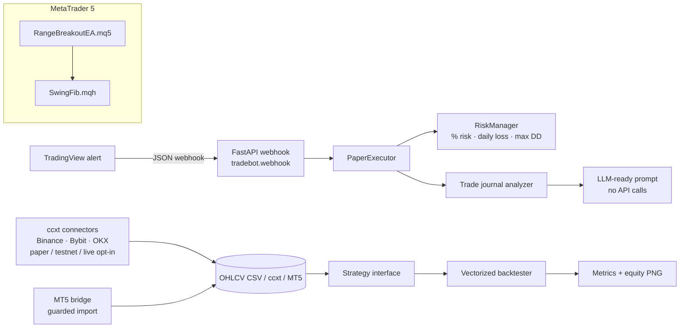
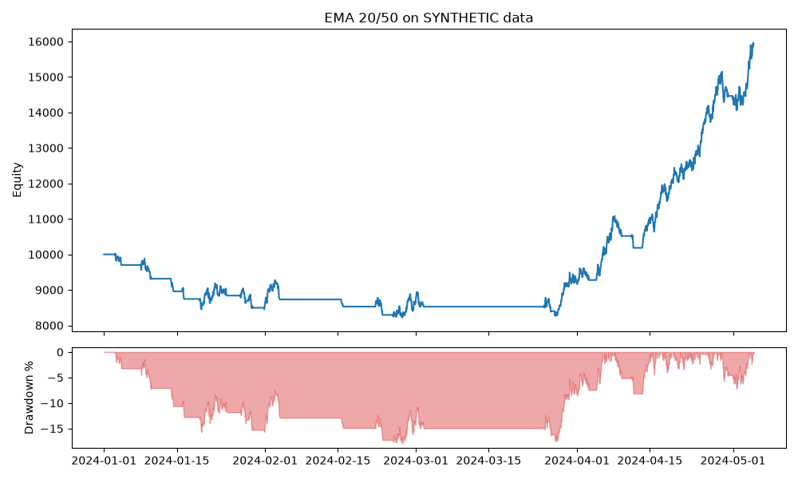

# Trading Automation Portfolio

A working, tested portfolio of trading-automation building blocks:
- an **MT5/MQL5 Expert Advisor** with prop-firm risk controls
- a **Python crypto bot toolkit** that covers ccxt connectors (Binance, Bybit, OKX), a risk manager, a vectorized backtester, a TradingView webhook, an optional MetaTrader 5 bridge and trade-journal analytics

**Hire me:** I build custom MT5/MQL5 EAs, Python crypto bots, TradingView automation and backtests. [Contact me on Upwork](https://www.upwork.com/freelancers/~01f2d28a00fa4262d3).

> ⚠️ **Disclaimer:** This repository is for educational and demonstration purposes only. It is **not financial advice**, and it makes no claim that any strategy is profitable. Trading carries substantial risk of loss. Every connector runs in **paper mode by default**. Run anything only on paper or demo/testnet accounts, at your own risk.

## Architecture



## Features mapped to common client requests

| Client need | Where |
|---|---|
| MT5 EA with risk management and a trailing stop | `mql5/RangeBreakoutEA.mq5`: % risk lots, ATR trail, partial TP |
| Prop-firm drawdown protection (gold/FX EAs) | Daily loss limit and max-DD guard in the EA and in `tradebot.risk` |
| ZigZag / Fibonacci entries | `mql5/Include/SwingFib.mqh` |
| Multi-exchange Python bot (Binance, Bybit, OKX) | `tradebot.connectors.exchange`: paper by default, keys only from env vars |
| Strategy optimization and backtesting | `tradebot.backtest`: CAGR, max DD, Sharpe, win rate, profit factor, equity PNG |
| TradingView / Pine Script alerts → execution | `tradebot.webhook`: FastAPI receiver with a shared secret, feeding the paper executor |
| Python ↔ MT5 integration | `tradebot.mt5_bridge`: optional, Windows only |
| AI analysis of past trades | `tradebot.journal`: stats plus an LLM-ready prompt |
| Reliability | 26 offline pytest tests, ruff, GitHub Actions CI |

## Repository layout

```
mql5/                    MT5 Expert Advisor + include (see mql5/README.md)
python/tradebot/
  connectors/            ccxt exchange factory + paper executor
  strategies/            Strategy ABC + EmaCrossStrategy example
  backtest.py            vectorized backtester and metrics
  risk.py                position sizing, daily loss, max drawdown
  webhook.py             FastAPI TradingView receiver
  mt5_bridge.py          optional MetaTrader5 bridge
  journal.py             trade-journal stats + LLM prompt
  data.py                CSV loading + deterministic synthetic data
data/                    SYNTHETIC sample OHLCV + journal (not real prices)
scripts/                 generate data, run backtest, analyze journal
tests/                   offline pytest suite
```

## Quickstart

```bash
python -m venv .venv && source .venv/bin/activate
pip install -e ".[dev,exchange,webhook]"
ruff check . && pytest -q
python scripts/run_backtest.py            # metrics + docs/equity_curve.png
python scripts/analyze_journal.py         # LLM-ready journal prompt
TRADEBOT_WEBHOOK_SECRET=change-me uvicorn tradebot.webhook:app --port 8000
```

Send a TradingView alert (message body):
```json
{"secret": "change-me", "symbol": "BTC/USDT", "side": "buy", "qty": 0.01, "price": 65000}
```

Exchange keys come only from environment variables (`BINANCE_API_KEY`/`BINANCE_API_SECRET`, `BYBIT_…`, `OKX_…` + `OKX_API_PASSWORD`). Use `mode="testnet"` for the exchange sandbox. Live trading requires both `mode="live"` and `TRADEBOT_ALLOW_LIVE=1`.

## Backtest results (bundled synthetic data)

These are the actual output of `python scripts/run_backtest.py`: `EmaCrossStrategy(20, 50)`, long-only, 5 bps fee + 2 bps slippage per side, run on `data/synthetic_btcusdt_1h.csv`. That file holds 3,000 hourly bars of **synthetic** prices from a seeded random walk. **The data is synthetic, so these numbers say nothing about real-market performance.** They only show that the pipeline runs end to end.

| Metric | Value |
|---|---|
| Total return | 59.14% |
| CAGR | 288.34% (annualized from ~4 months of synthetic bars, which makes it meaningless) |
| Max drawdown | -17.95% |
| Sharpe | 3.76 |
| Trades | 20 |
| Win rate | 35.0% |
| Profit factor | 3.12 |



## MQL5 EA

See [`mql5/README.md`](mql5/README.md) for compile and Strategy Tester instructions. The EA has **not been compiled in CI**, because MetaEditor is Windows-only. Compile it and test it on a demo account before use.

## Hire me / contact

Need an EA, a crypto bot, a TradingView webhook or a backtest built or fixed? Send me a message on **Upwork:** https://www.upwork.com/freelancers/~01f2d28a00fa4262d3

## License
MIT
